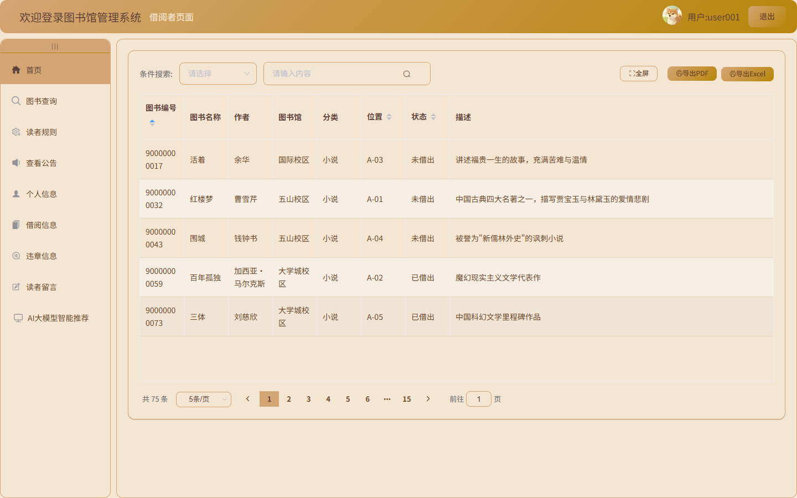
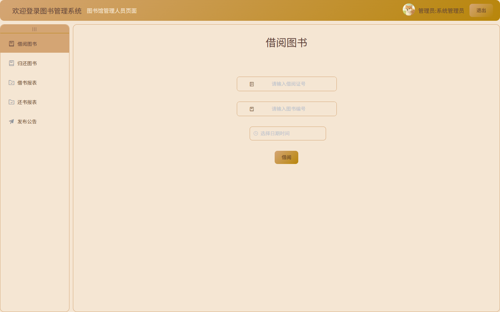
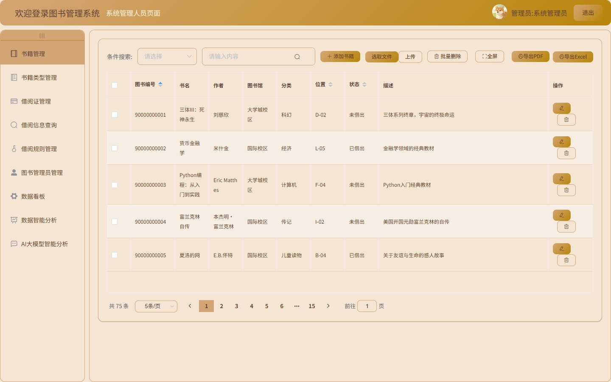
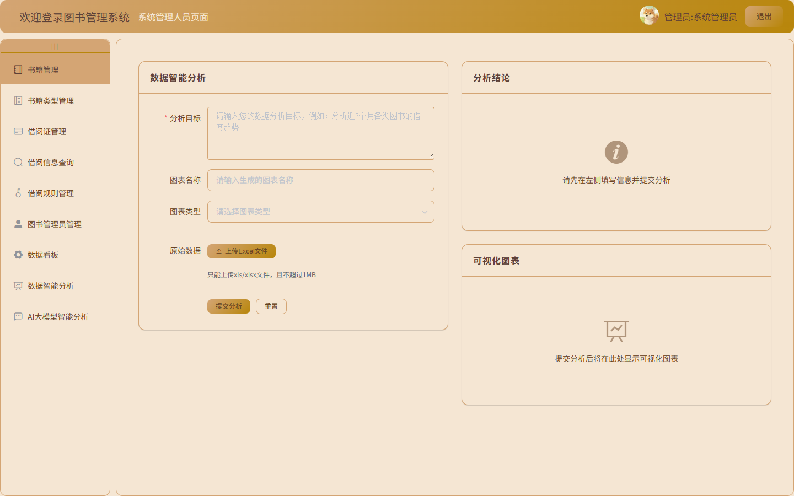

<div align="center">

# AI 图书馆管理系统

**Spring Boot + Vue 2 + MySQL 的前后端分离图书借阅管理系统，内置讯飞星火大模型的智能推荐与自然语言数据分析。**

[](https://www.oracle.com/java/)
[](https://spring.io/projects/spring-boot)
[](https://v2.vuejs.org/)
[](https://www.mysql.com/)
[](LICENSE)

</div>

---

## 目录

- [项目简介](#项目简介)
- [功能概览](#功能概览)
- [界面预览](#界面预览)
- [技术栈](#技术栈)
- [系统架构](#系统架构)
- [快速开始](#快速开始)
- [配置说明](#配置说明)
- [项目结构](#项目结构)
- [技术实现要点](#技术实现要点)
- [已知问题](#已知问题)
- [后续计划](#后续计划)
- [说明](#说明)

---

## 项目简介

一个面向校园场景的图书借阅管理系统，本科毕业设计作品，2026 年 5 月完成答辩。

系统分**管理员 / 图书管理员 / 读者**三种角色、三条独立登录链路，覆盖图书从入库、分类、借出、归还到逾期与违规处理的全流程，并提供评论、公告、借阅规则维护等配套功能。

在常规 CRUD 之外，系统接入了**讯飞星火大模型**，用于两个实际场景：

- **读者端**：结合读者的历史借阅记录做个性化图书推荐
- **管理端**：上传 Excel 后用自然语言描述需求，直接生成 ECharts 图表配置与分析结论文本

AI 部分的客户端代码是照着星火开放平台的 HTTP 协议**手写**的（签名、WebSocket 流式响应、token 用量统计、错误码映射），没有使用官方 SDK。

---

## 功能概览

### 读者端

| 功能 | 说明 |
|---|---|
| 图书检索 | 分页查询、按书名 / 作者 / 分类筛选 |
| 在线借阅 | 借书申请、归还、查看当前借阅与历史借阅 |
| 逾期与违规 | 查看逾期记录、违规处罚记录与借阅规则 |
| 评论 | 对图书发表评论、查看他人评论 |
| 公告 | 查看管理员发布的公告 |
| 智能推荐 | 基于个人借阅历史的 AI 图书推荐，带对话历史 |
| 个人信息 | 修改资料、修改密码 |

### 图书管理员端

| 功能 | 说明 |
|---|---|
| 借还办理 | 按图书编号借书 / 还书，自动校验图书状态 |
| 状态查询 | 查询图书当前借阅状态、逾期信息 |
| 借还记录 | 分页查看借阅流水与归还流水 |
| 公告管理 | 发布、修改、删除公告 |

### 管理员端

| 功能 | 说明 |
|---|---|
| 图书管理 | 增删改查、批量删除、Excel 批量导入、封面与信息维护 |
| 分类管理 | 图书分类的增删改查 |
| 借阅规则 | 维护借阅时长、可借数量、逾期罚则 |
| 账号管理 | 读者账号（借阅证）与图书管理员账号的增删改查、启用禁用 |
| 数据统计 | 借阅趋势、分类占比等图表 |
| 智能分析 | 上传 Excel → 自然语言描述 → 生成图表 + 分析结论 |
| AI 对话记录 | 查看历史对话，系统每 24 小时自动清理过期记录 |

接口总数约 60 个，启动后可访问 Knife4j 在线文档调试：`http://localhost:8080/api/doc.html`

---

## 界面预览

| 读者端 · 首页 | 读者端 · 图书查询 |
|---|---|
|  |  |
| **读者端 · AI 大模型智能推荐** | **图书管理员端 · 借阅办理** |
|  |  |
| **管理员端 · 书籍管理** | **管理员端 · 数据智能分析** |
|  |  |

---

## 技术栈

### 后端

| 类别 | 选型 |
|---|---|
| 语言 / 运行时 | Java 8 |
| 框架 | Spring Boot 2.7.8 |
| 持久层 | MyBatis-Plus 3.5.1 + 16 个自定义 XML Mapper |
| 数据库 | MySQL 8.0（HikariCP 连接池） |
| 认证鉴权 | JWT（jjwt 0.9.0）+ 自定义 `HandlerInterceptor` |
| 接口文档 | Knife4j（OpenAPI 2） |
| Excel | EasyExcel（后端导入导出） |
| AI | 讯飞星火（自研 `SparkClient`：okhttp + Java-WebSocket + HMAC-SHA256 签名） |
| 限流 | Guava `RateLimiter` |
| 工具 | Lombok、Hutool、Gson、fastjson |

### 前端

| 类别 | 选型 |
|---|---|
| 框架 | Vue 2.6 + Vue Router 3 |
| UI 组件 | Element UI 2 |
| 图表 | ECharts 5 |
| HTTP | axios（请求/响应拦截器统一注入 Token、统一错误提示） |
| 导出 | html2canvas + jsPDF（PDF）、xlsx（Excel） |
| 构建 | Vue CLI 5，dev / prod 双入口（`main-dev.js` / `main-prod.js`） |

---

## 系统架构

```
┌─────────────────────────────────────────────────────────────┐
│  浏览器（Vue 2 SPA）                                          │
│  三个入口：/login（读者） /loginmanage（图书管理员） /loginadmin（管理员）│
│  axios 拦截器：携带 Authorization: Bearer <token>              │
└───────────────────────────┬─────────────────────────────────┘
                            │ HTTP / JSON
┌───────────────────────────▼─────────────────────────────────┐
│  Spring Boot  /api                                           │
│                                                              │
│  AuthInterceptorHandler                                      │
│    └─ 解析 JWT → 取出角色 → 校验「请求路径」与「角色」是否匹配     │
│       过期 → 401；越权 → 拒绝                                  │
│                                                              │
│  Controller（按角色分包）                                      │
│    ├─ controller/admin     管理员：图书 / 分类 / 规则 / 账号 / 统计 │
│    ├─ controller/bookadmin 图书管理员：借书 / 还书 / 逾期 / 公告    │
│    └─ controller/user      读者：检索 / 借阅 / 违规 / 评论 / AI     │
│                                                              │
│  Service（接口 + Impl）                                        │
│    ├─ 统一返回体 R<T>                                          │
│    └─ GlobalExceptionHandler 统一兜底业务异常                    │
│                                                              │
│  Mapper（MyBatis-Plus + XML）                                 │
└───────────────────────────┬─────────────────────────────────┘
                            │ JDBC
┌───────────────────────────▼─────────────────────────────────┐
│  MySQL  ai_library（13 张表）                                  │
└─────────────────────────────────────────────────────────────┘

AI 支线：
  AiIntelligentServiceImpl / ChartServiceImpl
    → SparkClient（HMAC-SHA256 签名 → okhttp 请求星火接口）
    → Guava RateLimiter 限流
    → user_interface_info 记录调用次数与配额
    → 对话内容落 ai_intelligent 表
    → IncSyncDeleteAIMessage 定时任务（每 24h）清理过期记录
```

---

## 快速开始

### 环境要求

- JDK 8
- Maven 3.6+
- MySQL 8.0+
- Node.js 14+ / npm

### 1. 初始化数据库

```bash
# 建库
mysql -u root -p -e "CREATE DATABASE ai_library DEFAULT CHARSET utf8mb4;"

# 导入表结构与初始数据
mysql -u root -p ai_library < ai_library_backend/sql/ai_library.sql
```

### 2. 配置后端

```bash
cd ai_library_backend/src/main/resources
cp application-local.yml.example application-local.yml
```

编辑 `application-local.yml`，填入数据库口令与讯飞星火凭证（没有 AI 凭证也能跑，只是 AI 接口会返回明确的"未配置"提示）。

### 3. 启动后端

```bash
cd ai_library_backend

# 指定 local 配置档启动（读取 application-local.yml）
mvn spring-boot:run -Dspring-boot.run.profiles=local
```

启动成功后：

- 服务地址：`http://localhost:8080/api`
- 接口文档：`http://localhost:8080/api/doc.html`

### 4. 启动前端

```bash
cd ai_library_frontend
npm install
npm run serve     # 开发模式，默认 http://localhost:8081
```

前端开发模式默认把请求代理到 `http://localhost:8080/api/`（见 `src/main-dev.js`），如端口不同请自行调整。

### 5. 演示账号

初始数据内置三种角色的账号，密码均为 `123456`：

| 角色 | 登录入口 | 账号 |
|---|---|---|
| 读者 | `/#/login` | `user001` |
| 图书管理员 | `/#/loginmanage` | `admin` |
| 系统管理员 | `/#/loginadmin` | `root` |

### 打包部署

```bash
# 后端
cd ai_library_backend && mvn clean package -DskipTests

# 前端
cd ai_library_frontend && npm run build      # 产物在 dist/
```

前端生产入口 `main-prod.js` 通过 `VUE_APP_API_BASE_URL` 指定后端地址，未设置时走同源。

---

## 配置说明

所有敏感配置均**不写入仓库**，通过环境变量或本地配置文件提供。

| 环境变量 | 用途 | 默认值 |
|---|---|---|
| `SPRING_PROFILES_ACTIVE` | 激活的配置档 | `dev` |
| `DB_HOST` / `DB_PORT` / `DB_NAME` | 数据库地址 | `localhost` / `3306` / `ai_library` |
| `DB_USERNAME` / `DB_PASSWORD` | 数据库账号 | `root` / 空 |
| `JWT_SECRET` | JWT 签名密钥 | 占位串（部署务必替换） |
| `SPARK_APP_ID` | 讯飞星火 APPID | 空 |
| `SPARK_API_KEY` | 讯飞星火 APIKey | 空 |
| `SPARK_API_SECRET` | 讯飞星火 APISecret | 空 |

`application-local.yml` 已在 `.gitignore` 中排除，不会被提交。

> 讯飞星火凭证申请：<https://console.xfyun.cn/>（有免费额度）

---

## 项目结构

```
ai-library/
├── ai_library_backend/                 # Spring Boot 后端
│   ├── sql/
│   │   └── ai_library.sql              # 建表 + 初始数据（13 张表）
│   └── src/main/
│       ├── java/com/book/backend/
│       │   ├── controller/
│       │   │   ├── admin/              # 管理员接口
│       │   │   ├── bookadmin/          # 图书管理员接口
│       │   │   └── user/               # 读者接口
│       │   ├── service/                # 业务接口
│       │   │   └── impl/               # 业务实现
│       │   ├── mapper/                 # MyBatis-Plus Mapper
│       │   ├── pojo/                   # 实体 / DTO / VO
│       │   ├── manager/                # 星火客户端（SparkClient 等）
│       │   ├── interceptor/            # JWT 鉴权拦截器
│       │   ├── job/                    # 定时任务
│       │   ├── common/                 # 统一返回体、异常、分页
│       │   ├── config/                 # MVC / MyBatis / JSON 配置
│       │   └── utils/                  # JWT、Excel、数字工具
│       └── resources/
│           ├── application.yml         # 公共配置
│           ├── application-dev.yml     # 开发环境（读环境变量）
│           ├── application-prod.yml    # 生产环境（读环境变量）
│           ├── application-local.yml.example  # 本地私有配置模板
│           └── mapper/                 # 16 个 XML Mapper
│
└── ai_library_frontend/                # Vue 2 前端
    └── src/
        ├── components/
        │   ├── Admin/                  # 管理员页面
        │   ├── BookManage/             # 图书管理员页面
        │   ├── User/                   # 读者页面
        │   ├── Home/                   # 三种角色的布局壳
        │   ├── Chart/                  # ECharts 封装
        │   └── Utils/                  # 导出工具
        ├── router/index.js             # 路由表（按角色分组 + 懒加载）
        ├── main-dev.js                 # 开发模式入口
        └── main-prod.js                # 生产模式入口
```

---

## 技术实现要点

### 1. 手写讯飞星火协议客户端

`manager/SparkClient.java` 没有依赖官方 SDK，直接按开放平台协议实现：

- **鉴权**：`HmacSHA256(apiSecret, "host: xxx\ndate: xxx\nGET /v3.5/chat HTTP/1.1")` 生成签名，拼进 `Authorization` 头
- **请求**：okhttp 发起 HTTP 请求，请求体用 Gson 序列化成星火约定的 JSON 结构
- **响应**：`SparkBaseListener` 处理流式返回，`SparkSyncChatResponse` 聚合完整结果
- **可观测**：`SparkTextUsage` 统计 prompt / completion token 消耗；`SparkErrorCode` 把平台错误码映射成中文提示

### 2. 三角色权限模型

不是简单的"登录后全通"，而是在 `AuthInterceptorHandler` 里做**路径级角色校验**：

```
请求路径前缀  →  允许的角色
/admin/**     →  admin
/bookadmin/** →  bookadmin
/user/**      →  user
```

JWT 载荷里带角色，拦截器解析后比对；Token 过期返回 401，角色不符直接拒绝。

### 3. AI 调用限流与配额

`GuavaRateLimiterManager` 控制调用速率，`user_interface_info` 表按「用户 × 接口」记录累计调用次数，超过配额直接拒绝。目的是防止 AI 接口被单个账号刷穿。

### 4. 长耗时 AI 请求的超时控制

`AiIntelligentServiceImpl` 用 `ExecutorService` + `Future.get(timeout)` 包住星火调用，避免大模型响应慢时把 Tomcat 线程池拖死。

### 5. 统一返回体与全局异常

`R<T>{status, msg, data}` 贯穿所有接口；`GlobalExceptionHandler` 统一捕获 `BusinessException` 与未预期异常，前端拦截器按 `status` 统一弹提示，业务代码里不需要写 try-catch。

---

## 已知问题

作为毕业设计，以下问题是明确知道的，写在前面而不是藏着：

| 问题 | 说明 | 是否计划修 |
|---|---|---|
| 密码仍为 MD5 + 全局固定盐 | 为了兼容历史数据未改动；正确做法是 BCrypt + 每用户独立盐 | 计划 |
| 无单元测试 | `src/test` 为空，核心链路（借还书、逾期计算）缺测试保护 | 计划 |
| `AiIntelligentServiceImpl` 624 行 | 提示词拼装、数据查询、落库混在一起，属于上帝类 | 计划拆分 |
| 三套 JSON 库共存 | fastjson + gson + Jackson，版本与安全公告都要跟三份 | 可合并 |
| Vue 2 / Element UI 已停止维护 | 项目保持 2026 年答辩时的真实状态，未做框架升级 | 不计划 |
| 部分 Controller 存在重复 CRUD | 三种角色的增删改查结构高度相似，可抽公共基类 | 可抽 |

---

## 后续计划

- [ ] 密码改为 BCrypt 加盐存储，兼容迁移旧数据
- [ ] 补借还书主链路与逾期计算的单元测试
- [ ] 拆分 `AiIntelligentServiceImpl`，把提示词模板独立出去
- [ ] 提供 `docker-compose.yml`，一条命令起 MySQL + 后端 + 前端
- [ ] 接入 GitHub Actions 做编译与测试

---

## 说明

本项目为华南理工大学软件工程专业本科毕业设计，2026 年 5 月完成答辩。

代码保留答辩时的真实状态（Java 8 + Spring Boot 2.7 + Vue 2），没有为了"看起来新"而升级框架版本——它是那个时间点上我能写出的最好的代码。

仓库内的演示数据已做脱敏：借阅证号统一为 `2026xxxxxxx` 段，图书编号统一为 `9xxxxxxxxxx` 段，演示账号为 `user001` ~ `user003`，管理员显示名为「系统管理员」，不含任何真实手机号、邮箱或姓名；AI 对话演示记录也已替换为通用内容。

如果这个项目对你有帮助，欢迎 star。有问题可以提 issue。
